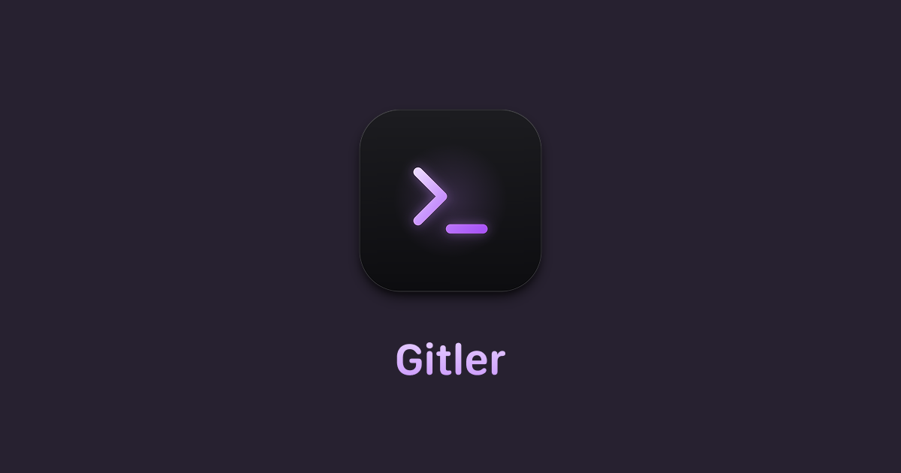

<p align="center">
  
</p>

<h1 align="center">Git Mate</h1>

<p align="center">
  Your repositories, in clear view.<br>
  A local Git client for macOS, with an AI copilot that runs on your Mac.
</p>

<p align="center">
  <a href="https://github.com/artemsvit/GitMate/actions/workflows/check.yml"></a>
  <a href="https://github.com/artemsvit/GitMate/releases/latest"></a>
  <a href="LICENSE"></a>
</p>

<p align="center">
  <a href="https://github.com/artemsvit/GitMate/releases/download/v1.4.1/GitMate-1.4.1-arm64.dmg"><b>Download v1.4.1 for Apple Silicon</b></a>
  &nbsp;·&nbsp;
  <a href="https://gitmate.artsvit.com">Website</a>
  &nbsp;·&nbsp;
  <a href="docs/GUIDE.md">Guide</a>
  &nbsp;·&nbsp;
  <a href="https://github.com/artemsvit/GitMate/releases">Release notes</a>
</p>

<p align="center">
  macOS 12 or later · Apple Silicon · Developer ID signed and notarized
</p>

<a href="https://gitmate.artsvit.com">
  
</a>

## Built for your daily Git work

| Feature | What you can do |
| --- | --- |
| **Repository workspace** | Scan a folder, find repositories, and see changes and commits ahead or behind. |
| **Changes and history** | Stage individual files, review text and image previews, and inspect commit details. |
| **Branches and graph** | Switch local branches, check out remote branches, and follow branches, merges, and tags in the graph. |
| **Verified pushes** | Commit once and push to several destinations. Each remote is checked for the exact commit; failed destinations can be retried. |
| **Local AI Copilot** | Suggest commit messages from staged changes, explain commits, and ask questions about repository code. |
| **Accounts and connections** | Connect GitHub, GitLab, Gitea, or Forgejo. Set up a dedicated SSH key and test access. |
| **macOS controls** | Use native menus, keyboard shortcuts, saved interface zoom, and an update window with release notes. |

## Get started

1. [Download the DMG](https://github.com/artemsvit/GitMate/releases/download/v1.4.1/GitMate-1.4.1-arm64.dmg), open it, and drag **Git Mate** to **Applications**.
2. Open Git Mate and choose a folder to scan for Git repositories.
3. Select a repository to review changes, stage files, and commit. Configure remote access when you are ready to fetch or push.

Git features require **macOS 12 or later on Apple Silicon**. On-device Copilot requires **macOS 14 or later** and a downloaded model. Local repositories work offline.

Already using Gitler? Git Mate moves your accounts, SSH keys, downloaded models, chats, and settings automatically on first launch.

## AI that runs on your Mac

Choose a model in **Settings → AI Models**, or connect a local model running in **LM Studio** or **Ollama**. Downloads support pause, resume, and checksum verification.

| On-device model | Download size | Minimum memory |
| --- | --- | --- |
| Qwen3.5 0.8B | 0.5 GB | 4 GB |
| Qwen3.5 2B | 1.3 GB | 8 GB |
| Qwen3.5 4B | 2.7 GB | 8 GB |
| Qwen3.5 9B | 5.7 GB | 16 GB |
| Qwen3.6 27B | 16.8 GB | 32 GB |

Sizes are approximate. Git Mate suggests a model based on your Mac’s memory and keeps your saved choice. You can switch or delete models in Settings.

Without a model, commit suggestions use built-in rules. Copilot Chat can read repository context and explain its sources; it cannot edit files, run commands, commit, or push.

## Privacy

- AI prompts, code context, and chats stay on your Mac. Git Mate has no analytics or telemetry.
- Remote Git operations contact your configured Git hosts. Model downloads and update checks also use the network.
- LM Studio and Ollama connections use `127.0.0.1`. Cloud-hosted Ollama models are not offered.
- Conversations are saved per repository. You can delete them in Copilot Chat.

## Keyboard shortcuts

| Action | Shortcut |
| --- | --- |
| Open a folder | ⌘O |
| Rescan repositories | ⌘R |
| Find a repository | ⌘F |
| Open Changes / History / Remotes / Graph | ⌘1 / ⌘2 / ⌘3 / ⌘4 |
| Show or hide AI Copilot | ⌥⌘C |
| Open Settings | ⌘, |
| Zoom in / out / reset | ⌘+ / ⌘− / ⌘0 |

## Development

Requires **Node.js 22.12 or later** and **Git**. CI uses Node.js 24 on macOS.

```bash
npm ci
npm run dev          # API on :3001, interface on :3000
npm run check        # TypeScript checks and tests
npm run dev:desktop  # Build and open the Electron app
npm run dist:dir     # Package a local macOS app without publishing
```

Local packaging alone does not verify signing or notarization. See the [guide](docs/GUIDE.md) for authentication, storage, model behavior, and the [release process](docs/GUIDE.md#stable-release-process).

## Feedback and license

[Report a bug or request a feature](https://github.com/artemsvit/GitMate/issues) · [MIT license](LICENSE) · Artem Svitelskyi
