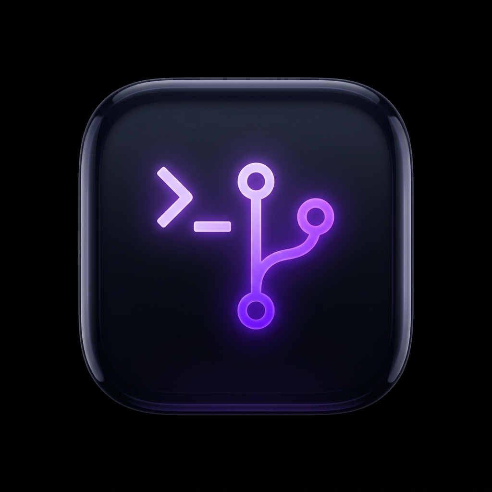

<p align="center">
  
</p>

<h1 align="center">Git Mate</h1>

<p align="center">
  A local Git client for macOS, with an AI copilot that runs on your Mac.
</p>

<p align="center">
  <a href="https://github.com/artemsvit/GitMate/releases/latest"><b>Download for macOS</b></a>
  &nbsp;·&nbsp;
  <a href="https://gitmate.artsvit.com">Website</a>
  &nbsp;·&nbsp;
  <a href="https://github.com/artemsvit/GitMate/releases">Release notes</a>
  &nbsp;·&nbsp;
  <a href="docs/GUIDE.md">Guide</a>
</p>

<br>

## Overview

- **All your repositories in one window.** Scan a folder and see which repositories have changes, are ahead, or are behind.
- **Changes, history, and a graph.** Stage files, read diffs and image previews, and follow every branch, merge, and tag in the Graph tab.
- **Push with proof.** Commit once, push to one or more destinations, and Git Mate reads each remote back to confirm the exact commit arrived.
- **AI Copilot.** Commit messages written from your staged changes, and a chat that answers questions about your code.
- **Accounts and SSH.** GitHub, GitLab, and Gitea or Forgejo, with a dedicated SSH key and connection tests.
- **Signed updates.** Notarized releases with release notes, and updates you can skip or install on quit.

## Requirements

macOS 12 or later on Apple Silicon. Copilot Chat needs macOS 14 or later.

## AI models

Copilot runs on a model you download once, or on a model you already run in LM Studio or Ollama.

| Model | Download | Memory |
| --- | --- | --- |
| Qwen3.5 4B | 2.7 GB | 8 GB |
| Qwen3.5 9B — recommended | 5.7 GB | 16 GB |
| Qwen3.6 27B | 16.8 GB | 32 GB |

Choose, download, or delete models in **Settings → AI Models**. Without a model, commit messages come from built-in rules.

## Privacy

- Your code, diffs, and chats stay on your Mac. Git Mate has no analytics or telemetry.
- Network access is limited to your Git hosts, model downloads, and update checks.
- LM Studio and Ollama are reached only on `127.0.0.1`; cloud-hosted Ollama models are not offered.

## Development

Requires Node.js 22.12 or later and Git.

```bash
npm install
npm run dev          # API on :3001, interface on :3000
npm run check        # type check and tests
npm run dev:desktop  # build and open the Electron app
npm run dist:dir     # local, unsigned macOS app
```

Releases are built, signed, and notarized by GitHub Actions from a version tag. See the [guide](docs/GUIDE.md#stable-release-process) for the full process.

## License

MIT · Artem Svitelskyi
